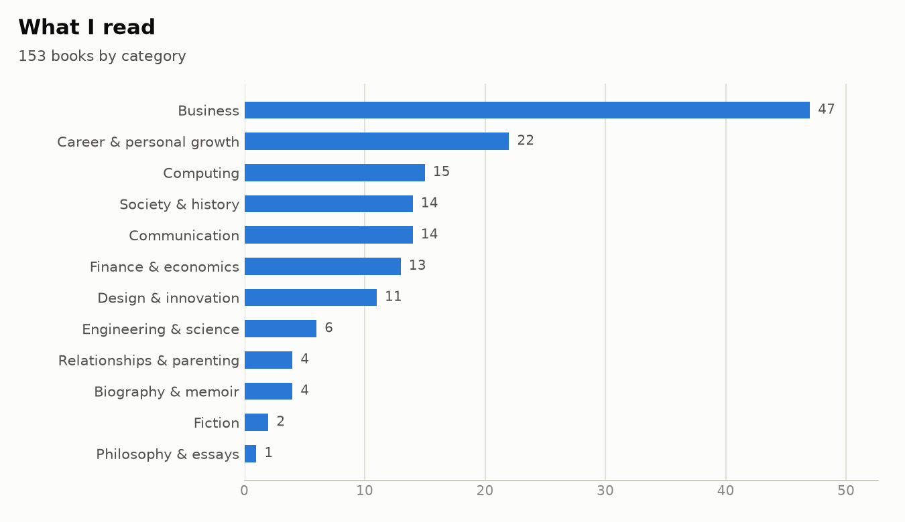
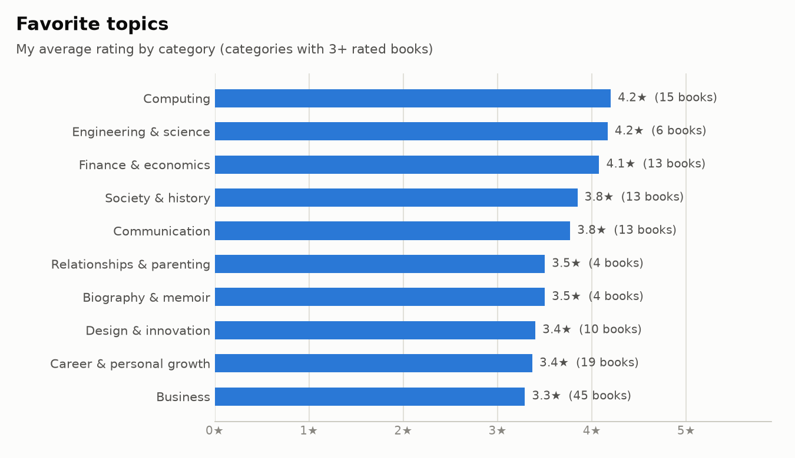
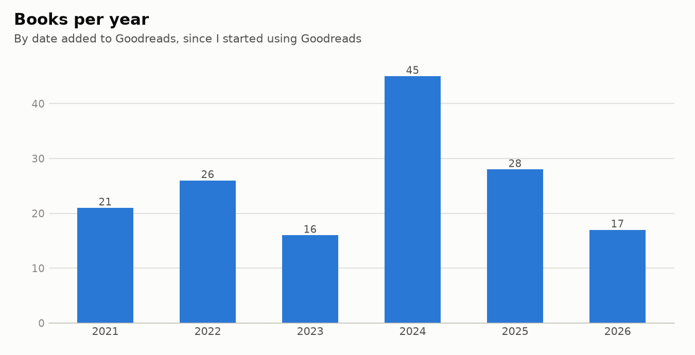
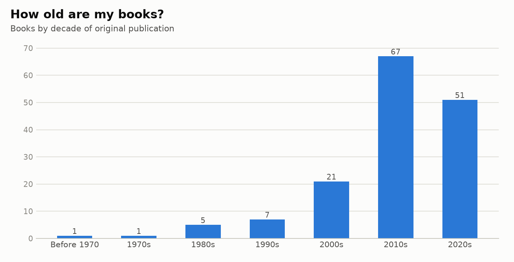

# Bookshelf analysis

Charts and stats from my Goodreads reading history.

## At a glance

<!-- stats:start -->
| Stat | Value |
|---|---|
| Books on the shelf | 153 |
| Finished | 142 |
| Did not finish | 10 (7%) |
| My average rating | 3.61★ (Goodreads: 4.00★) |
| Favorites | 22 |
| Hottest take | *Product Management in Practice*: I gave it 2★, Goodreads says 4.34★. I prefer Project Management for the Unofficial Project Manager's approach |
<!-- stats:end -->

## Charts

<picture>
  <source media="(prefers-color-scheme: dark)" srcset="charts/books-by-category-dark.png">
  
</picture>

<picture>
  <source media="(prefers-color-scheme: dark)" srcset="charts/rating-by-category-dark.png">
  
</picture>

<picture>
  <source media="(prefers-color-scheme: dark)" srcset="charts/books-per-year-dark.png">
  
</picture>

<picture>
  <source media="(prefers-color-scheme: dark)" srcset="charts/publication-decades-dark.png">
  
</picture>

## Run it

Requires [uv](https://docs.astral.sh/uv/).

```sh
uv run scripts/clean.py    # raw Goodreads export -> data/books.csv
uv run scripts/charts.py   # data/books.csv -> charts/*.png + stats above
```

`clean.py` reads `books - Sheet4.csv` by default

## About the data

- Source: a Goodreads library export, with a category and subcategory added to each book.
- The raw export is not committed (see `.gitignore`). `data/books.csv` is the cleaned copy:
  review text, notes and a few personal subcategories are removed.
- "Books per year" uses the date each book was added to Goodreads, since the export has no read dates.
- Ratings of 0 mean unrated and are left out of the averages.
